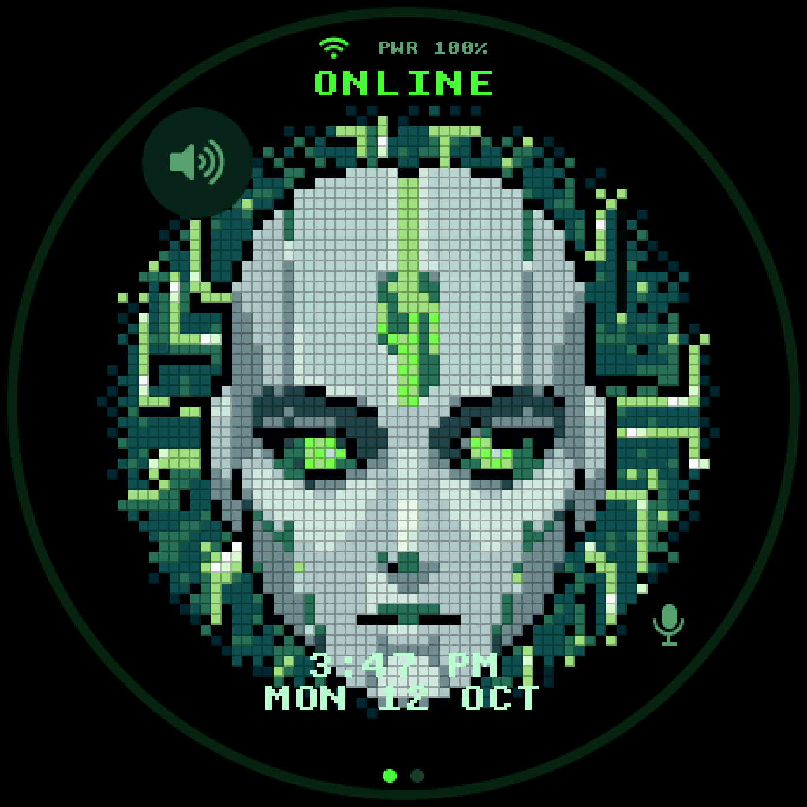
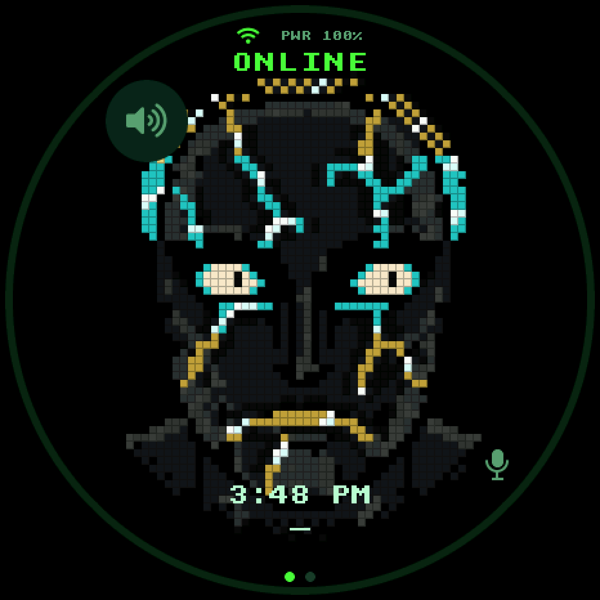
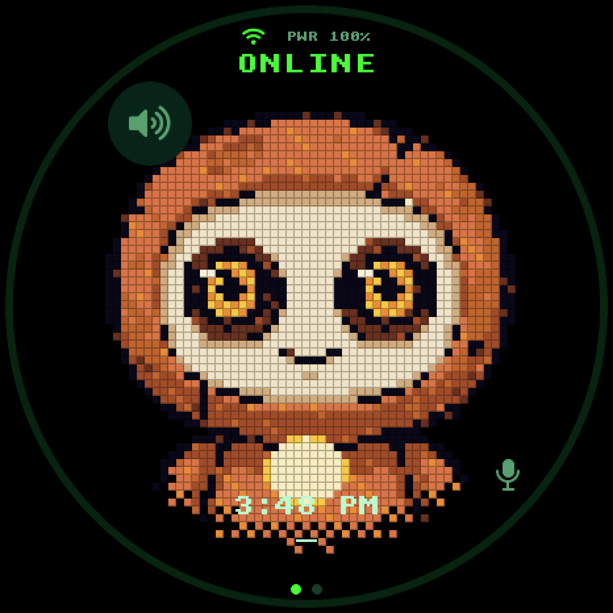
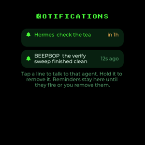

<!--
Copyright (c) Meta Platforms, Inc. and affiliates.

Licensed under the Apache License, Version 2.0 (the "License");
you may not use this file except in compliance with the License.
You may obtain a copy of the License at

    http://www.apache.org/licenses/LICENSE-2.0

Unless required by applicable law or agreed to in writing, software
distributed under the License is distributed on an "AS IS" BASIS,
WITHOUT WARRANTIES OR CONDITIONS OF ANY KIND, either express or implied.
See the License for the specific language governing permissions and
limitations under the License.
-->

# 🔒 Hermes fork — a three-agent Muse gadget

**This repo is a fork of [`facebookincubator/muse-gadget-sdk`](https://github.com/facebookincubator/muse-gadget-sdk),
developed on the `hermes-local` branch (the default branch here).** Upstream
turns the Waveshare ESP32-S3 1.43″ round AMOLED board into a voice companion for
the Muse cloud agent; this fork turns the same hardware into a **switchable
companion for three different agents** — it talks to the one you picked, reaches
out on its own when things happen, and survives the display freezes the stock
firmware panics on.

<p align="center">
  
  
  
</p>

<p align="center">
  
  
</p>

<p align="center"><i>The three faces — SHODAN (Muse), the stone god (Hermes), the jade golem (ALT) — all
captured on the actual 466×466 panel · Settings with the Agents row and a live Notifications
count · the on-device inbox, where amber <code>in 1h</code> is a reminder the agent set by voice</i></p>

---

## What this fork adds

### 🎭 Three agents, one button

| Slot | Default | Face | Path |
|---|---|---|---|
| Muse | SHODAN | pixel SHODAN | Muse cloud VM |
| Hermes | default profile | **stone god** | Mac relay → Hermes |
| ALT | any named profile (e.g. `beepbop`) | **jade golem** | Mac relay → that profile |

**Double-tap** the talk button cycles slots (gesture pinned by a host test: tap
< 300 ms, 1.2 s window; a long press is never a tap). **Settings → Agents** is a
direct radio-select with each agent's own logo, plus a text-entry row for the ALT
profile name — an ALT without a name is dimmed and refuses selection because the
relay can't route it. Each agent gets its own **voice** (relay-side `voice_name`),
its own **face** (three avatar renderers built side by side under renamed
symbols, with a 1.5 s glitch + sound transition), and its own routing
(`&profile=` on every relay URL). Settings migrate NVS-safely from the old
two-slot world.

### 📬 The reverse channel — the gadget reaches out on its own

Every other gadget interaction is poll ("you ask, it answers"). This one is the
opposite: the Mac relay **pushes a short line** and the device wakes, chirps,
speaks it, captions it with a tap hint — and tapping opens the *exact agent that
raised it*.

- **On-device inbox** (Settings → Notifications, with an unread count on the menu
  row): tap a line to switch to that agent, **hold to remove** it. Read history is
  kept server-side, so a nudge that went stale before you looked is still there.
- **Voice-set timers** — say *"remind me in 10 minutes to take the tea out"* and
  the agent ends its reply with a `[remind:10m take the tea out]` tag; the relay
  turns it into a due-dated line and strips it from speech. The device presents it
  when the clock passes — zero firmware timer logic.
- **Failed prints shout** — the print watcher raises an `alert` nudge on a
  printing → ERROR/CANCELLED transition (a 9-hour print dying at hour 8 must not
  be discovered by walking over), not just on success.

### 🛡️ Display-freeze survivability + a black box

Three decoded coredumps traced the stock freezes to **two upstream ESP-IDF bugs**
in `spi_bus_lock.c` (both patched locally and re-applied before every build, with
upstream issue references) plus a class of *lost panel-completion interrupts*
that firmware must survive rather than fix:

- **Two-level LCD guard** — bounded chunk waits + a 250 ms watchdog for lost
  completions (the screen keeps drawing over the incomplete band), and a
  driver-call stall detector that dumps interrupt state and cleanly reboots in
  ~4 s instead of a 20 s freeze + abort.
- **LVGL's untimed flush-wait replaced** — a lost "flush done" notify parked
  LVGL in `while(disp->flushing);` forever; now a `flush_wait_cb` waits on the
  real condition and writes off the wait past 1 s.
- **NVS black box** (`>diag` over serial, cable or not) — freezes happen off-USB
  and a clean restart leaves no coredump, so the last restart's *reason* and the
  display state at the trip are recorded in NVS.
- **Fault injection for every defense** — `>lcd.swallow`, `>lcd.dropnotify`,
  `>lcd.wedge` prove each path on the bench without hardware that loses signals.

### 🔋 Power, for a board with no reset key

- Restart paths everywhere: **hold the talk button 20 s**, menu Restart, settings
  button, console `>reboot`, and a Mac-side DTR/RTS pulse that works on a fully
  hung firmware. A watchdog hard ceiling means a frozen screen always
  self-reboots.
- **Coredumps go to flash** (120 KB partition, 32-task dump) so a panic leaves a
  backtrace even with nobody watching the port; every flash archives its matching
  ELF so dumps always decode.
- **Battery: warn at 15 %, protect the cell at 5 %** — both on the EMA-smoothed
  percentage (the raw voltage gauge sags ~10 points under radio load), the cue
  plays without waking the screen, and 5 % deep-sleeps instead of dying.
- **Light sleep** (tickless idle, Wi-Fi retained) for the idle-current win.

### 🔗 Connectivity

- **Relay LAN announce + reachability cache** fixed 7-second turns: the Mac relay
  announces its LAN address, the gadget prefers it over the compiled-in URL and
  probes netmask-aware.
- **Wi-Fi saved-network switching**: tap = switch (joins by name with the target's
  own stored password — never through a credential write), hold = forget,
  range-checked against the scan the settings page actually did.
- Post-pairing 401 loop fixed (the chat session now uses the provisioned access
  token, not the SDK identity token); the cross-agent task bridge repaired end to
  end (idempotency collision, stranded cards, false-success completion).

### 🖼️ Avatars & UI

Three hand-built pixel faces with baked mood frames, per-agent reactions, reading
mode per agent, and a **palette-read discipline** that eliminated the
random-panic class (every framebuffer read-back is bounds-guarded against dynamic
indices). Connection colors are a canonical palette (ok green / working amber /
fault red). 207 hardware-free host tests keep input gestures, session logic and
caption wrapping honest; a UART snapshot hook (`tools/muse/snap.py`) captures the
real screen for UI review.

<p align="center">
  
  
  
</p>

<p align="center"><i>Resting-behaviour loops rendered through the shipping renderers — per-face blink
cadence, saccades, breathing and the signature accent beats (Stage C)</i></p>

---

## Changelog (the `hermes-local` branch)

71 commits over upstream `main` — newest first. Full detail lives in the commits
themselves.

| Area | Commits | What |
|---|---|---|
| docs | `c54ae8c` | This README + `HERMES-FORK.md` |
| input/UX | `25669b5` `29226a8` `80ce6e3` | Talk-button timing (a 2 s gate was built, tried, reverted on user feedback — press-to-talk is instant); settings menu resets on entry; SHORT_CLICKED rows |
| battery | `e112a1d` | 15 % warning + 5 % cell-protection, on the smoothed gauge |
| LCD | `60c762b` `f905305` `4b541d2` | The three freeze defenses: lost-flush backstop, driver-stall detector, lost-completion recovery |
| diag | `a48d183` `2f74770` | The NVS black box + restart-path naming |
| notifications | `ee3cba6` `bc0fab1` `d128b64` `ea12cb8` `31c64ca` `a6d5ced` `453115d` | The reverse channel end to end: push → tap-to-open, spoken line + chime, staleness guards, the wake-deadlock fix |
| agents | `91bb056` `92df4d8` `2cb11e6` `5e7b0be` `a6ba9d2` `5181243` | Three-way agent slot with NVS migration; double-tap cycle; Agents settings page; real logo icons |
| avatars | `38148ae` `33cb2ba` `a158f55` `baa1927` `1e7be77` `c14a224` `e58418e` `3c5247d` `834f155` `6be680a` | Three faces; the palette-read guards (the panic class); the Jade Golem + reactions; SHODAN pose library; tracked face sources |
| perf | `228ace2` `c7960fd` | Parallel TTS workers + renderer hot-loop cuts; light sleep |
| relay | `35c7523` `882b926` `f4a2fdb` | LAN announce (7 s → snappy turns); bearer fix for the 401 loop; 403 retry brake |
| tasks | `b450bde` `d49b272` `0e5ee14` | Cross-agent task bridge, end to end |
| recovery | `402a788` `4683558` `13e518a` | Coredumps to flash; restart paths for a dead PWR switch; pairing survives BLE stalls |
| wifi | `8729991` `fec08e5` `c8b763f` | Switch only when in range; SSID and leak fixes; auth/backoff hardening |
| audio | `fda8a73` `42feaaf` | Mic gain 30→36 dB (bench-verified); audio path fixes |
| base | `466f14c` … `0b0bbbb` | Waveshare 1.43C board, Hermes agent mode, streaming turns, the first avatars and transition sound |
| misc | `fa1af1a` `007920c` `f749df5` `828d0b7` `482afcc` `8a64488` `ae43010` `d318efd` | Reply-too-long caption; PSRAM decoder move; debug dir gitignored; repo hygiene |

<details>
<summary><b>All 71 commit subjects</b></summary>

```
c54ae8c docs: HERMES-FORK.md — what this fork adds, and a README banner
25669b5 voice: revert the 2 s talk gate — press-to-talk is instant again
29226a8 gadget UX: talk gate, settings menu reset, notification rows
80ce6e3 gadget: failed-print alerts, voice reminders, touch filter, PSRAM buffers
e112a1d battery: warn at 15%, protect the cell at 5% (no more silent death)
828d0b7 opencode: track the project MCP config (matches the Fairhollow convention)
482afcc audit: delete the retired faces, dedupe the spree policy
60c762b lcd: catch the lost-flush shape too -- the 2026-10-08 panic loop
2f74770 diag: name the menu/hold restart path in the black box too
a48d183 diag: the gadget's black box -- restart reasons survive off-USB reboots
f905305 lcd: catch the driver-level wedge too -- the 2026-10-08 freeze
4b541d2 lcd: survive a lost panel completion (the L2 freeze)
fa1af1a feat: say "reply too long" when a frame outgrows the session
35c7523 hermes: fix 7s turns -- relay LAN announce + reachability cache + probe fix
007920c memory: notification mp3 decoder in PSRAM, not internal DRAM
5181243 agent icons: track the generated icon headers (avatar/ is gitignored)
a6ba9d2 agent icons: use the user's own logos, rendered white, 40x40
5e7b0be agents page: real icons (Meta + Hermes marks); wifi: tap=switch, hold=forget
8729991 wifi: switch only when the target is in range; repair path
f749df5 gitignore: esp32/debug (coredump scratch + decoded dumps)
453115d fix: notification wake deadlock (panic on battery); wifi switch; hermes 'note sent'
a6d5ced notif.pcm: use universfield 'new notification 012' (real chime, not the synth tone)
31c64ca notifications: speak + wake + a dedicated chime
ea12cb8 avatar gestures: tap and long-press now independent by construction
bc0fab1 notifications: hint on its own caption line (wrapped mid-message before)
d128b64 notifications: staleness/pending guards, caption sizing; settings: round-safe list top
ee3cba6 notifications: reverse channel (relay->device), tap opens the exact agent
38148ae avatar: three faces (shodan/stone/golem) selected by agent slot
2cb11e6 agents: settings selector page + 2-tap cycle fix + Sadachbia voice
91bb056 agents: three-way agent slot (Muse / Hermes / Hermes ALT profile) -- enum settings with NVS migration, 3-way double-tap cycle, per-turn &profile= on every relay URL, status JSON, task metadata, deep-sleep soft-off for the dead PWR switch
92df4d8 input: agent switch is a DOUBLE tap now (was triple); gesture pinned by a host test (tap<300ms, window 1.2s, long press is not a tap)
402a788 coredump: panics now write to a flash partition (120KB @ 0x7E2000, 32-task dump) instead of UART -- the 2026-10-06 boot panics lost their backtraces to an unwatched port
6be680a avatar: Hermes face is the stone god (muse_pixel_stone.c); golem kept for revert
4683558 recovery: restart paths for a board with no reset key -- hold BOOT 20s; menu/tab Restart; console >reboot; watchdog hard ceiling with BLE on; reset_gadget.py on the Mac
33cb2ba avatar: guard every palette read-back against dynamic indices (the panic class: light pass paints >= SPR_N indices, SPR_PAL has SPR_N rows) -- SHODAN, Golem, Construct, Keller
c14a224 avatar: track the built face sources (12 files, was 5) -- branch is now self-contained
7e58b1f config: 52 board settings + the PM/light-sleep block move into the tracked 143c profile; check_sdkconfig guards PM (a fresh reconfigure now loses only the 3 secrets)
c8b763f fixes (A3,A4,B3,D2): no token prefixes in logs; silent press is not a dead Hermes link; task poll 2.5s timeout + unreachable backoff; power menu stops printing (null)
1e7be77 avatar(shodan): face from the baked Qwen pose library (27 poses from the Comfy pack; procedural eyes/brows/mouth removed; 190 host tests + motion gate green)
605e4d7 agents: show Hermes and Muse links independently (they were never coupled)
0e5ee14 task bridge + auth: fix collision, stranded cards, false success, OOB, backoff
f4a2fdb auth: brake the 403 retry loop and make the refresh actually refresh
b450bde cross-agent tasks: close the loop (Hermes text injection + completion)
a158f55 Golem: fix draw_motes/breath_band OOB palette read (random panic on battery)
d49b272 chat session: poll relay for queued tasks, inject as typed turns, strip [task:...] tags
ae43010 skills: gadget-muse-face replaces gadget-shodan-reactions
d318efd tools/muse: fail hard on a broken or truncated render
e58418e avatar(golem): +25 baked reactions (work/feelings/weather)
3c5247d Golem: eliminate dead frames and smooth the motion
834f155 Golem: fix broken reaction animations (mapping, clipping, floaters)
228ace2 Batch: parallel relay TTS workers (order-preserving, ~2.4s -> 0.3s inter-sentence), renderer hot-loop pixel lists (vignette 4096->~1100, light/shimmer 4096->~1240 visits; 50/50 frames pixel-identical vs pre-opt), dead-code sweep
8e7a07b UI consistency: canonical connection-status palette (OK green / working amber / fault red / off dim) for the wifi+Ble icons and the idle ONLINE word — no longer tinted by the avatar accent (which differs per agent/mode); BLE icon color follows state not text; one green everywhere (settings 6ff0bf -> 4dff3c); keypad/menu purple palettes -> theme green; failed=red consistently
c7960fd Enable CONFIG_PM + tickless idle: auto light-sleep with WiFi retained (the 10x idle-current lever); the code was already PM-aware (console RX wake, battery callbacks, cpu-low locks)
a2e1b57 Battery: revert quarter-rate idle on user request; recalibrate the meter's 100% anchor to 4.10 V (the charger's relaxed CV termination — a full cell never idled at 4.2)
fb3007c Battery: smoothed gauge (EMA on %, raw mV), power-save poll 100->250ms, idle face quarter-rate on battery
882b926 Muse chat bearer fix: the chat session's fetch_vms now asks the app layer for the provisioned access token (refreshed on refusal) instead of the hatch slot's SDK identity token — resolves the post-pairing 401 loop
13e518a Pairing survives the BLE display stall: watchdog aborts only after a 60 s grace following any BLE activity; the power-off UI button now correctly says the board's power is hardware-owned
fec08e5 esp32: fix SSID truncation, task-create leaks and other small firmware bugs
baa1927 Hermes avatar: the Jade Golem (round-6 pick). Picture-based renderer with jade state recolours, breathing chest core, moss shimmer; diegetic weather/prop moods
5b6ece7 Reading view per agent: last reply kept in one store per agent; long-press shows the active agent's own text
22ed73f Hermes streamed turns: write the reading view (last_reply) from the streamed reply so a long-press shows the Hermes text, not a stale Muse reply
2f57cc0 Hermes streaming turns: relay pushes NDJSON (heard/status/tts/reply), gadget plays MP3 chunks as they arrive and shows agent-work captions; old JSON path kept
fda8a73 Mic gain default 30 -> 36 dB: bench sweep showed -54 dBFS whisper-level speech; 36 dB lifts voice ~15 dB with the floor unchanged (slots fix)
42feaaf Audio path fixes: mic slots 0+2 only (was 4-slot average), codec open rollback, PTT queue-drop handling, pooled capture scratch, watchdog warn-then-abort (BLE-aware), idle half-rate frames, PSRAM avatar buffers
f1adb9c Hermes agent: replace the Bloop avatar with the Construct (picture-based, own renderer)
89b9430 Agent switch: play the user's transition sound over the glitch (embedded PCM, voice task, FX-free)
8a64488 Add repo context graph (graft) wiring: AGENTS.md + ignore entries
114796d Agent switch: glitch transition between the two avatars; Hermes relay tweaks
bd745f4 Keep turn_start identical to upstream: Hermes mode lives in ensure_connected
0b0bbbb Merge upstream main (15 commits) into hermes-local
466f14c Waveshare 1.43C board, Google TTS voice, SHODAN/Bloop avatars, Hermes agent mode, reactions
```

</details>

---

## Setting up the device (no app required to build)

1. **Wi-Fi** — on the device itself: `Settings -> Wi-Fi`, pick your network from the
   scanned list, type the password on the touch keyboard. The Muse app also sets Wi-Fi
   during its BLE pairing, if you use Muse.
2. **A computer-accessible console** — over USB serial (115200 baud): `>status` prints
   the full device state (agent, Wi-Fi, battery, link). Other console commands let you
   set the active agent (`>agent=muse|hermes|alt`), switch/forget saved networks
   (`>wifi.switch=<ssid>`, `>wifi.forget=<ssid>`), seed a relay address
   (`>relay.lan=<ip>`) and more. Everything is in-firmware — no companion app or
   external tool is needed to operate the device.
3. **Muse credentials** (only if you use the Muse cloud agent): pair once with the Muse
   app on iOS/Android (`Settings > Devices`, developer mode on, look for `MuseGadget`).
   You need an SDK token from [gadgets.muse.ai](https://gadgets.muse.ai/settings/sdk-tokens)
   at build time; without one the firmware still **builds and runs fine**, it just will
   not pair with Muse (the build logs a warning).

## Connect an agent — Hermes, Muse, or anything else

The firmware itself is an agent *client*, not an agent: it records your voice, sends it
to a server you point it at, and speaks the reply it gets back. Three transports exist:

- **Muse cloud** — out of the box after app pairing. No config needed.
- **Your own relay/agent** — set `CONFIG_MUSE_HERMES_URL` (home address) and
  `CONFIG_MUSE_HERMES_URL_REMOTE` (works from anywhere, e.g. a Tailscale funnel) in your
  board profile / `idf.py menuconfig`. The device then sends turns to that HTTP endpoint
  and speaks the replies. A reference implementation of the tiny contract — ~300 lines
  of stdlib Python with pluggable STT/TTS — is `hermes-relay`; the full wire protocol is
  in [`docs/AGENT-PROTOCOL.md`](docs/AGENT-PROTOCOL.md). Point it at Hermes, at any
  OpenAI-compatible endpoint, or at your own script.
- **Anything else** — any service that implements the `/turn` contract (POST text or
  audio in, reply out; optional NDJSON streaming with per-sentence TTS chunks) works.
  The contract is documented, small, and transport-agnostic.

## Repo layout

```
esp32/components/muse/          the companion itself (this fork's center of work)
  muse_chat_session.cpp         session task: turns, tasks, notifications, inbox fetch
  muse_voice.c                  push-to-talk, pre-roll, held notes, sound flags
  muse_settings_ui.c            every settings page incl. Agents + Notifications
  muse_lcd_bands.c              panel driver + the two freeze guards
  muse_diag.c/.h                the NVS black box
  avatar/                       three faces + icon headers (tracked, self-contained)
  boards/board_waveshare_s3_143c.c   the target board
esp32/tests/                    198 hardware-free host tests
```

The reference relay (`hermes-relay`: agent routing, STT/TTS, the notification store)
is a separate repo and not included here — [`docs/AGENT-PROTOCOL.md`](docs/AGENT-PROTOCOL.md)
documents the wire contract so you can write your own.

## Building & testing

Toolchain and board instructions are upstream's (unchanged). Host tests:

```bash
cd esp32 && env -u PYTHONPATH python3 -m unittest discover -s tests -p 'test_*.py'
```

On the author's machine a wrapper (`build_flash.sh`) hard-gates the device
secrets before every build, verifies them inside the built binary, and archives
the ELF+bin for coredump decoding.

## Secrets

**No key material in this repo.** Device secrets live only in untracked
`build-*/sdkconfig` files and are re-applied at build time; test fixtures use
visibly fake placeholder tokens. `esp32/debug/` and local graph caches are
gitignored.

**No personal data either** (2026-10-13 sweep): the tracked board profile ships with
empty relay URLs, every personal path was removed from the authoring scripts (env vars
with generic defaults), and the repo is checked clean of hostnames, LAN addresses,
e-mails and device identifiers. **Security shape:** the device is a client — it listens
on nothing, keeps credentials in NVS, validates TLS with the bundled root certs, and its
debug console is reachable only over physical USB serial. Your agent server is the trust
boundary: put a token on it (the reference relay does) if you expose it beyond your LAN.

## Syncing with upstream

```bash
git fetch upstream
git rebase upstream/main hermes-local
```

Upstream `main` is kept untouched as the rebase base; `hermes-local` is linear.

---

<details>
<summary><b>Upstream's own README</b> (the unmodified project description)</summary>

# Muse Gadgets

<p align="center">
  <picture>
    <source media="(prefers-color-scheme: dark)" srcset=".github/images/muse-gadgets-dark.png">
    
  </picture>
</p>

Muse gadgets are open source devices you build yourself. Program an
off-the-shelf ESP32 board or set up a Raspberry Pi with our device SDKs, then
connect Muse to your displays, buttons, sensors, actuators, and whatever else
you've got lying on your workbench.

We open sourced the SDKs and firmware here. It's built by hackers, for hackers,
just for fun. Side effects of tinkering may include bricked boards, voided
warranties, brownouts, or bankruptcies. Proceed at your own risk!

| | |
|---|---|
| [**ESP32 Device SDK**](esp32) | Connect your ESP32 board to Muse through our open source SDK. Throw in a screen to show images, add audio in and out, or wire up other sensors. |
| [**Linux Device SDK**](linux) | Turn that spare Raspberry Pi or Linux box into a Muse gadget. Hack in your own commands to let Muse handle sysadmin chores or your Home Assistant setup. |

Before you flash or pair a gadget, get an
[SDK token](https://gadgets.muse.ai/settings/sdk-tokens) and review the
[Gadget SDK Terms](https://gadgets.muse.ai/sdk-terms). Every gadget needs a
token to pair.

ESP32 and Linux gadgets pair with the Muse app on iOS and Android, via
Settings > Devices. Turn on Developer mode there first, then look for devices
prefixed with "MuseGadget".
Each directory has a `README.md` to get started and an `AGENTS.md` for coding
agents like [Muse Code](https://developer.meta.com/ai/lp/muse-code/).

## Community

Meet other hackers who are building and customizing Muse gadgets in our
community [Discord](https://discord.gg/3bhjCkZdd6). Get inspired, support each
other, and share what you make.

## License

Muse Gadgets is licensed under the Apache License, Version 2.0, found in
[`LICENSE`](LICENSE), except for these third-party files, which keep their
upstream licenses:

| Path | Upstream | License |
|---|---|---|
| [`esp32/components/minimp3/include/minimp3.h`](esp32/components/minimp3) | [lieff/minimp3](https://github.com/lieff/minimp3) | CC0-1.0, see [`LICENSE`](esp32/components/minimp3/LICENSE) |
| [`esp32/main/pixel_font.c`](esp32/main/pixel_font.c) | Adafruit GFX `glcdfont.c` | BSD-2-Clause, in the file header |

Dependencies fetched at build time are under their own licenses: ESP-IDF
components (into `esp32/managed_components/`), and the simulator's LVGL and
SDL (listed in [`esp32/simulator/THIRD_PARTY.md`](esp32/simulator/THIRD_PARTY.md)).

The Apache License does not cover the [Jollybot avatar](esp32/avatar).

</details>
