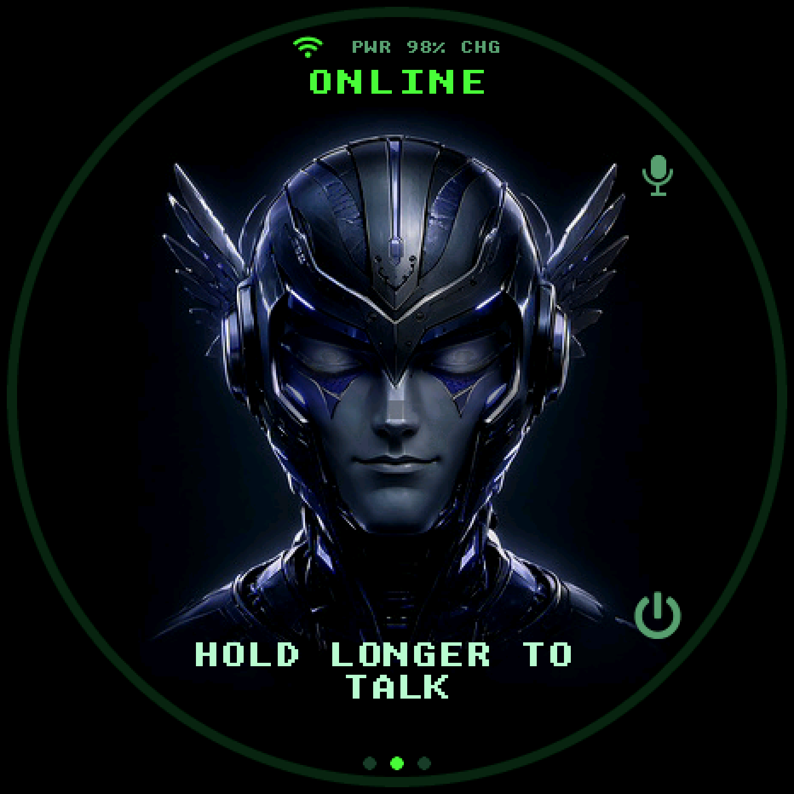
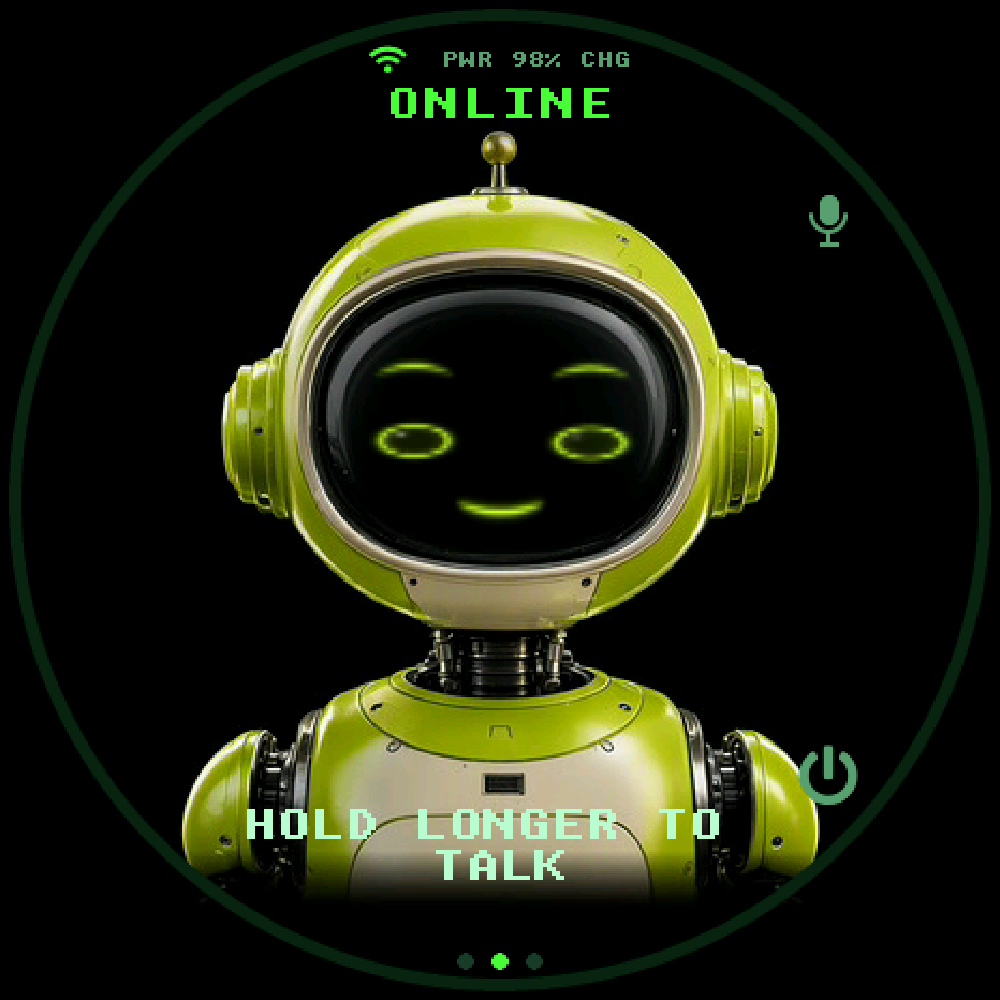
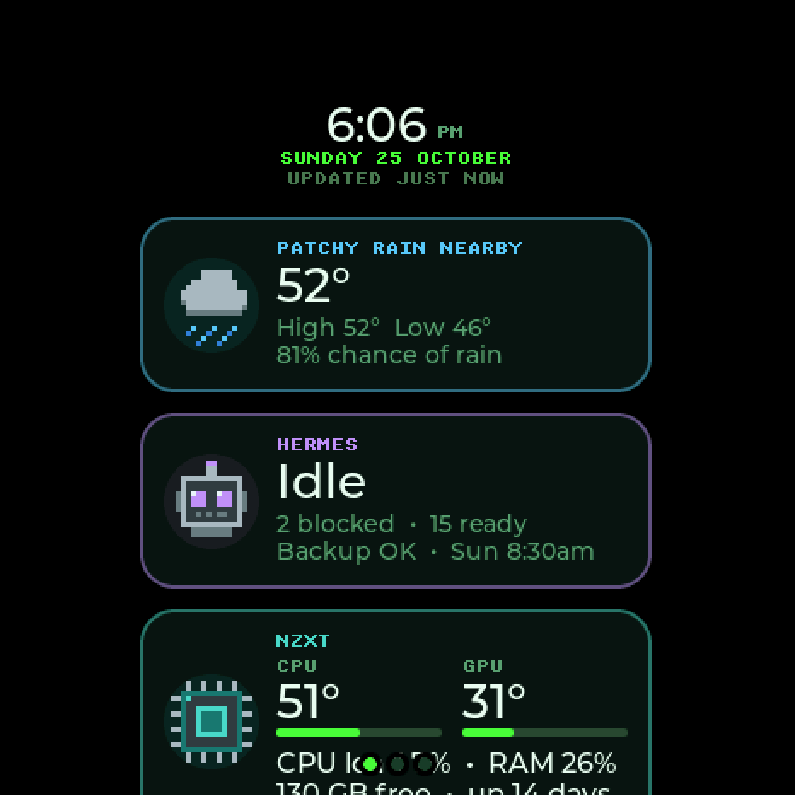
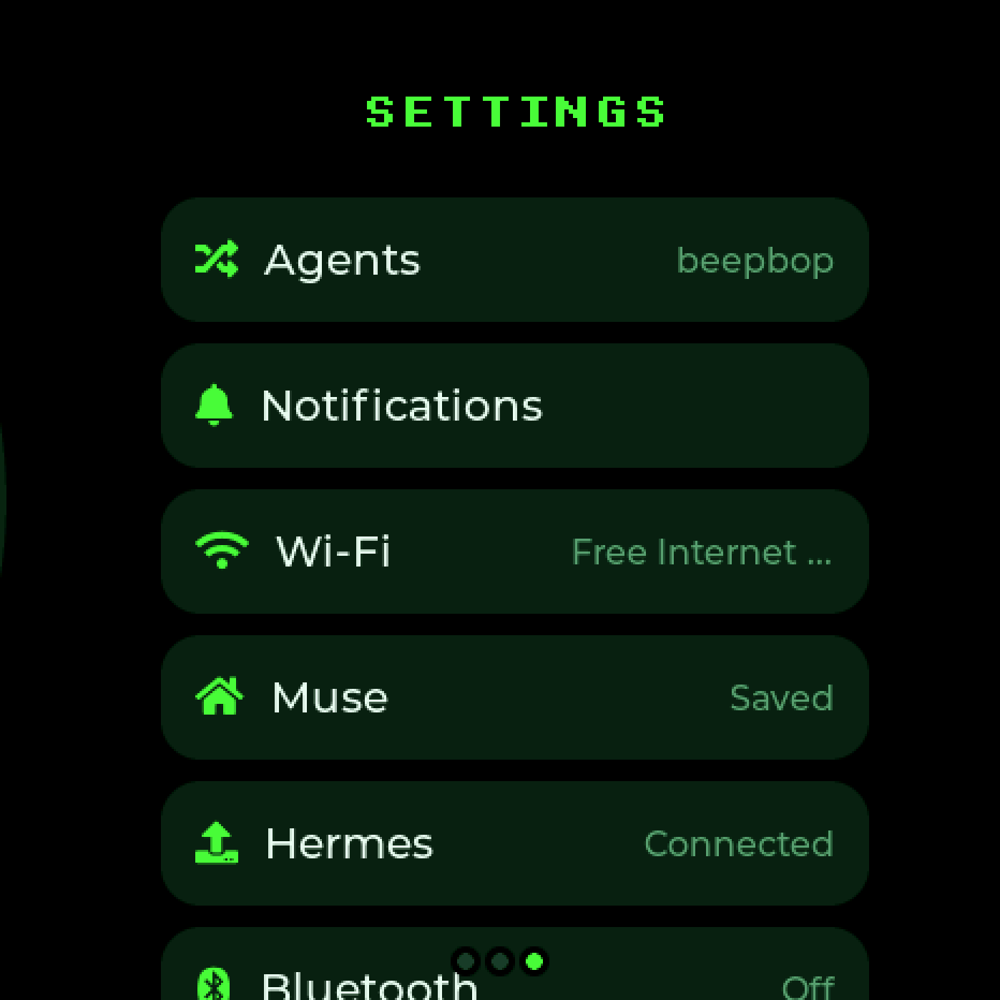
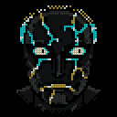

<!--
Copyright (c) Meta Platforms, Inc. and affiliates.

Licensed under the Apache License, Version 2.0 (the "License");
you may not use this file except in compliance with the License.
You may obtain a copy of the License at

    http://www.apache.org/licenses/LICENSE-2.0

Unless required by applicable law or agreed to in writing, software
distributed under the License is distributed on an "AS IS" BASIS,
WITHOUT WARRANTIES OR CONDITIONS OF ANY KIND, either express or implied.
See the License for the specific language governing permissions and
limitations under the License.
-->

# 🔒 Hermes fork — a three-agent Muse gadget

[](https://github.com/ozharsky/muse-gadget-sdk/actions/workflows/ci.yml)

**This repo is a fork of [`facebookincubator/muse-gadget-sdk`](https://github.com/facebookincubator/muse-gadget-sdk),
developed on the `hermes-local` branch (the default branch here).** Upstream
turns a Waveshare ESP32-S3 round AMOLED board into a voice companion for the Muse
cloud agent; this fork turns it into a **switchable companion for three different
agents** — it talks to the one you picked, reaches out on its own when things
happen, and survives the display freezes the stock firmware panics on. The board
this fork is developed and tested on is the **Waveshare ESP32-S3-Touch-AMOLED-1.75C**
(466×466 AMOLED, 16 MB flash + PSRAM); the 1.43C from upstream still builds
(`s3143c` profile) with the same features minus the portrait faces and TE frame
pacing.

**Building this with an AI?** [`docs/AI-SETUP.md`](docs/AI-SETUP.md) is a runbook written
to be executed end to end by an assistant (build → flash → connect). The agent wire
contract lives in [`docs/AGENT-PROTOCOL.md`](docs/AGENT-PROTOCOL.md).

<p align="center">
  
  
  
</p>

<p align="center">
  
  
</p>

<p align="center"><i>The three portrait faces — Muse, Hermes, BEEPBOP (ALT) — captured on the actual
466×466 panel · the Glance page with live cards (weather, agent state, home-server CPU/GPU) ·
Settings with the Agents row. Pixel faces remain one switch away (<code>&gt;portrait=0</code>)</i></p>

---

## What this fork adds

### 🎭 Three agents, one button

| Slot | Default | Face (1.75C) | Path |
|---|---|---|---|
| Muse | Muse | painted portrait, blue winged helmet (pixel SHODAN as fallback) | Muse cloud VM (pair via the app) |
| Hermes | default profile | painted portrait, circuit woman (pixel stone god as fallback) | your relay → Hermes (bundled in [`relay/`](relay)) |
| ALT | any named profile (here: `beepbop`) | painted portrait, green robot (pixel jade golem as fallback) | your relay → that profile |

Faces are **AI-painted portraits with rigged expressions, lip sync and light that
follows the voice**, loaded from the assets partition; `>portrait=0` swaps back to the
hand-built pixel faces without a reflash. Each portrait pack is generated with
`tools/muse/portrait_pack.py` and can be replaced with your own art.

**Double-tap** the talk button cycles slots (gesture pinned by a host test: tap
< 300 ms, 1.2 s window; a long press is never a tap). **Settings → Agents** is a
direct radio-select with each agent's own logo, plus a text-entry row for the ALT
profile name — an ALT without a name is dimmed and refuses selection because the
relay can't route it. Each agent gets its own **voice** (relay-side `voice_name`),
its own **face** (three avatar renderers built side by side under renamed
symbols, with a 1.5 s glitch + sound transition), and its own routing
(`&profile=` on every relay URL). Settings migrate NVS-safely from the old
two-slot world.

### 📬 The reverse channel — the gadget reaches out on its own

Every other gadget interaction is poll ("you ask, it answers"). This one is the
opposite: the relay **pushes a short line** and the device wakes, chirps,
speaks it, captions it with a tap hint — and tapping opens the *exact agent that
raised it*.

- **On-device inbox** (Settings → Notifications, with an unread count on the menu
  row): tap a line to switch to that agent, **hold to remove** it. Read history is
  kept server-side, so a nudge that went stale before you looked is still there.
- **Voice-set timers** — say *"remind me in 10 minutes to take the tea out"* and
  the agent ends its reply with a `[remind:10m take the tea out]` tag; the relay
  turns it into a due-dated line and strips it from speech. The device presents it
  when the clock passes — zero firmware timer logic.
- **Failed prints shout** — the print watcher raises an `alert` nudge on a
  printing → ERROR/CANCELLED transition (a 9-hour print dying at hour 8 must not
  be discovered by walking over), not just on success.

### 🛡️ Display-freeze survivability + a black box

Three decoded coredumps traced the stock freezes to **two upstream ESP-IDF bugs**
in `spi_bus_lock.c` (both patched locally and re-applied before every build, with
upstream issue references) plus a class of *lost panel-completion interrupts*
that firmware must survive rather than fix:

- **Two-level LCD guard** — bounded chunk waits + a 250 ms watchdog for lost
  completions (the screen keeps drawing over the incomplete band), and a
  driver-call stall detector that dumps interrupt state and cleanly reboots in
  ~4 s instead of a 20 s freeze + abort.
- **LVGL's untimed flush-wait replaced** — a lost "flush done" notify parked
  LVGL in `while(disp->flushing);` forever; now a `flush_wait_cb` waits on the
  real condition and writes off the wait past 1 s.
- **NVS black box** (`>diag` over serial, cable or not) — freezes happen off-USB
  and a clean restart leaves no coredump, so the last restart's *reason* and the
  display state at the trip are recorded in NVS.
- **Fault injection for every defense** — `>lcd.swallow`, `>lcd.dropnotify`,
  `>lcd.wedge` prove each path on the bench without hardware that loses signals.

### 🔋 Power, for a board with no reset key

- Restart paths everywhere: **hold the talk button 20 s**, menu Restart, settings
  button, console `>reboot`, and a host-side DTR/RTS pulse (`reset_gadget.py`) that
  works on a fully hung firmware. A watchdog hard ceiling means a frozen screen always
  self-reboots.
- **Coredumps go to flash** (120 KB partition, 32-task dump) so a panic leaves a
  backtrace even with nobody watching the port; every flash archives its matching
  ELF so dumps always decode.
- **Battery: warn at 15 %, protect the cell at 5 %** — both on the EMA-smoothed
  percentage (the raw voltage gauge sags ~10 points under radio load), the cue
  plays without waking the screen, and 5 % deep-sleeps instead of dying.
- **Light sleep** (tickless idle, Wi-Fi retained) for the idle-current win.

### 🔗 Connectivity

- **Relay LAN announce + reachability cache** fixed 7-second turns: the relay
  announces its LAN address in `/agents`, the gadget stores it and prefers it over
  the compiled-in URL; the reachability probe is cached and netmask-aware.
- **Wi-Fi saved-network switching**: tap = switch (joins by name with the target's
  own stored password — never through a credential write), hold = forget,
  range-checked against the scan the settings page actually did.
- Post-pairing 401 loop fixed (the chat session now uses the provisioned access
  token, not the SDK identity token). The cross-agent **tasking system was later
  removed whole (2026-10-10)** — its poll held the session task and slowed voice
  turns; reminders and notifications are the surviving reverse channels.

### 📊 Glance — the idle page earns its pixels

A dedicated page and a strip on the face: **live cards** for the weather, each
agent's state (idle / working / blocked tasks / next reminder) and the home
server's CPU/GPU temperatures and RAM, each with its own icon and accent colour.
Cards refresh when the page opens and every 30 s while it stays on screen, say
`UPDATED 3 MIN AGO` when stale, and are served by the relay's `/glance` endpoint
(or written by any script: `POST /glance`). Face-down quietly parks the device;
motion gestures from the QMI8658 (nod to answer, shake to dismiss) work on the 1.75C.

### 🗣️ Voice — streamed notes in, paced speech out

- The voice note **streams up while you speak** (chunked IMA-ADPCM, ~1/4 the
  bytes), so upload time shrinks and the display never blocks; the relay decodes
  it, falls back to local faster-whisper when Google STT is unavailable, and
  answers as NDJSON with **per-sentence TTS chunks** — speech starts ~3–5 s
  sooner than the whole-reply fetch era.
- Chirp 3 HD pacing on **both** paths (relay and device): every sentence ends in a
  `[pause short]` markup breath (`[pause]` after an ellipsis), so chunked replies
  stop sounding clipped. `TTS_RATE` (relay) / `CONFIG_MUSE_TTS_RATE_PCT` (device)
  set `speaking_rate`.
- **Pronunciation overrides** in IPA for names the voice mangles: the relay reads
  `relay/pronunciations.json`, the device carries the same table compiled in. A
  voice or locale that rejects markup or overrides falls back to plain text per
  sentence and logs one line — a reply never loses its voice.
- A 10 s decoded-reply buffer and empty-piece skipping keep the speaker fed even
  when one piece fails.

### ✅ Approvals on the glass

Destructive or system-wide commands the agent wants to run raise a **card on the
gadget**: tap allow or deny; the relay denies on its own timeout. Hermes runs with
manual approvals + unattended deny, so a stolen token alone cannot silently run a
command — someone has to tap the screen.

### 🧭 Always-on LAN door + watchdog

The relay lives on an always-on box; the gadget reaches it through a **LAN door**
(an always-on bridge in the gadget's own subnet, forwarded over Tailscale) and
falls back to the public funnel away from home. The door runs as a systemd unit
with `Restart=always`; a keeper task on the relay host curls relay, door and
funnel every 2 minutes and logs `DOOR DOWN` / `FUNNEL DOWN` verdicts; the relay
writes a timestamped, size-rotated log. A wrong LAN address announced by the relay
cannot poison the saved door silently (`RELAY_LAN_OVERRIDE` pins what it
announces).

### 🖼️ Avatars & UI

Painted portrait faces (Muse, Hermes, BEEPBOP) with rigged expressions, lip shapes
and light that follows the voice, over the original **hand-built pixel faces** with
baked mood frames, per-agent reactions and a **palette-read discipline** that
eliminated the random-panic class (every framebuffer read-back is bounds-guarded
against dynamic indices). Reading mode per agent, typewriter captions, a 12-hour
clock, and connection colours as a canonical palette (ok green / working amber /
fault red). **222 hardware-free host tests** keep input gestures, session logic,
TTS request shapes and caption wrapping honest; a UART snapshot hook
(`tools/muse/snap.py`) captures the real screen for UI review.

<p align="center">
  
  
  
</p>

<p align="center"><i>Pixel-mode resting loops, still shipped as the fallback (<code>&gt;portrait=0</code>) — per-face
blink cadence, saccades, breathing and signature accent beats</i></p>

---

## Changelog (the `hermes-local` branch)

166 commits over upstream `main` — newest first. Full detail lives in the commits
themselves.

| Area | Commits | What |
|---|---|---|
| voice (2026-10-25) | `b66633f` `033403b` `58c56fc` | Chirp 3 HD `[pause]` markup + IPA pronunciation overrides on relay **and** device (`pronunciations.json` / compiled table), `TTS_RATE`, per-path plain-text fallback; the JSON-quoting hotfix that restored Muse audio |
| relay hygiene (2026-10-25) | `1b246ea` | Deployed relay fork adopted into `relay/` (chunked ADPCM upload, `/glance`, `/history`, companion page, `stream_short`, beepbop profile) + hardening: 30 s socket timeout, body caps, timestamped rotated log, single-instance launcher, locked-screenshot retry, whisper worker stderr fix, UTF-8 config reads |
| stability (2026-10-25) | `f20bc97` | main stack 8K→16K (1.3 KB → 9.4 KB headroom), status reports the effective relay token, out-of-range agent falls back to Muse and logs what loaded |
| upstream picks (2026-10-24/25) | `2c54a4c` `f09f652` `a76307b` `d9c36f8` | Fast AES-GCM for the C5, `display.draw_file` over Noise, SDK-token pairing memory, VM-id/real-token settings rows |
| faces (2026-10-23/24) | `591af42` `8e3beea` | **AI-painted portraits** for Muse/Hermes/BEEPBOP with rigged expressions and lip shapes (`tools/muse/portrait_pack.py`, assets partition); light follows the voice, eyes follow you |
| agents (2026-10-22) | `8212568` | Muse stops running out of memory; a hung reply can't block the next note |
| door (2026-10-23) | `7aa9a43` `bccfdae` | Always-on LAN door (systemd + `Restart=always`), `RELAY_LAN_OVERRIDE`, `>dns=` bench; house art/voice tunings carried in the 175C profile |
| display (2026-10-22/23) | `2a89df3` `a27d2b6` `f09cc66` `0132817` | **Tear-free whole frames** at 80 MHz QSPI timed to the TE signal, 40/60 fps on USB and 25 on battery, frames never starved; iPhone link removed |
| glance (2026-10-20/23) | `7ef284e` `6bfc482` `a2c328f` `6df7cd1` | Glance page + idle cards (weather, agents, system/CPU/GPU), face-down quiet, nod/shake gestures, timezone at boot |
| speech (2026-10-21/23) | `aee1635` `1d3d60f` `4bbdbfa` | Voice notes stream up while spoken (chunked ADPCM), 10 s decoded-reply buffer, empty TTS pieces skipped |
| power/175C (2026-10-20/23) | `bded6ad` `4fcad72` `9d08ae8` | PWR is the talk button on the 1.75C (AXP2101 shutdown off); talk button only talks; PMU power state on screen; motion gestures |
| media/logs (2026-10-19/21) | `4808ba2` `1e484a7` `d7b56f4` `cc09427` | MJPEG clip player, flash asset pack, persistent log history in flash (`>log.dump/save/clear`) |
| setup | `8952e2c` `b3c2922` `93acda3` | The setup page's browser flow documented; **any agent** connectable from the page: relay host/URL/token over BLE + serial (NVS-backed, relay gates all runtime), *Your own agent* + Save & restart; `e2e_ble_setup.py` full-radio E2E; headless console helpers `>pair.code` `>ble.setup=` `>wifi.on=` |
| sharing | `a0583fe` `8918603` `19a5bed` `b8dfb13` `9d7db67` `5ce1023` | On-glass README artwork + idle GIFs, `docs/AGENT-PROTOCOL.md` + `docs/AI-SETUP.md`, the bundled `relay/` (suite green out of the box), personal-data sanitize; boot-repair self-heal for the lost-pairing state |
| art program | `51a575c` `345ee1b` `eadf69b` `f5b8c2b` `1da7a32` `937086a` `14f9c22` | Faces v2 on all three faces (A1/B3/C5), per-face idle personas + signature accent beats, easing rig, idle scheduler, moods v3 (all 52 reactions reworked), the on-device video player + indexed clip registry, `art-pipeline` toolchain landed in-repo |
| sessions | `af04f61` `ca9f534` | Turn backend pinned at start (the agent-flip race); Muse replies speak after the first TTS piece |
| tasking | `7f107a8` | The relay tasking system removed end to end (owner's call) |
| docs | `c54ae8c` | This README + `HERMES-FORK.md` |
| input/UX | `25669b5` `29226a8` `80ce6e3` | Talk-button timing (a 2 s gate was built, tried, reverted on user feedback — press-to-talk is instant); settings menu resets on entry; SHORT_CLICKED rows |
| battery | `e112a1d` | 15 % warning + 5 % cell-protection, on the smoothed gauge |
| LCD | `60c762b` `f905305` `4b541d2` | The three freeze defenses: lost-flush backstop, driver-stall detector, lost-completion recovery |
| diag | `a48d183` `2f74770` | The NVS black box + restart-path naming |
| notifications | `ee3cba6` `bc0fab1` `d128b64` `ea12cb8` `31c64ca` `a6d5ced` `453115d` | The reverse channel end to end: push → tap-to-open, spoken line + chime, staleness guards, the wake-deadlock fix |
| agents | `91bb056` `92df4d8` `2cb11e6` `5e7b0be` `a6ba9d2` `5181243` | Three-way agent slot with NVS migration; double-tap cycle; Agents settings page; real logo icons |
| avatars | `38148ae` `33cb2ba` `a158f55` `baa1927` `1e7be77` `c14a224` `e58418e` `3c5247d` `834f155` `6be680a` | Three faces; the palette-read guards (the panic class); the Jade Golem + reactions; SHODAN pose library; tracked face sources |
| perf | `228ace2` `c7960fd` | Parallel TTS workers + renderer hot-loop cuts; light sleep |
| relay | `35c7523` `882b926` `f4a2fdb` | LAN announce (7 s → snappy turns); bearer fix for the 401 loop; 403 retry brake |
| tasks | `b450bde` `d49b272` `0e5ee14` | Cross-agent task bridge, end to end |
| recovery | `402a788` `4683558` `13e518a` | Coredumps to flash; restart paths for a dead PWR switch; pairing survives BLE stalls |
| wifi | `8729991` `fec08e5` `c8b763f` | Switch only when in range; SSID and leak fixes; auth/backoff hardening |
| audio | `fda8a73` `42feaaf` | Mic gain 30→36 dB (bench-verified); audio path fixes |
| base | `466f14c` … `0b0bbbb` | Waveshare 1.43C board, Hermes agent mode, streaming turns, the first avatars and transition sound |
| misc | `fa1af1a` `007920c` `f749df5` `828d0b7` `482afcc` `8a64488` `ae43010` `d318efd` | Reply-too-long caption; PSRAM decoder move; debug dir gitignored; repo hygiene |

<details>
<summary><b>All 203 commit subjects</b></summary>

```
58c56fc muse voice: put the pause tag inside the JSON string
033403b muse voice: same breaths and pronunication table as the relay
b66633f relay: give the voice breath and correct the names
f20bc97 gadget: roomier main stack, honest relay-token row, safe agent fallback
1b246ea relay: adopt the deployed fork, harden the public door
2c54a4c C5: faster AES-GCM (cached GHASH tables, PSRAM staged through internal RAM) (#199)
f09f652 esp32: add display.draw_file, an image from the VM over Noise (#250)
a76307b esp32: remember the SDK token pairing used, and stop refreshing to report it (#221)
d9c36f8 Muse settings: VM in the VM ID row, real device token state, SDK token
8e3beea faces: light that follows the voice, eyes that follow you, lip shapes, a tell each
8212568 agents stay reachable: Muse no longer runs out of memory, a hung reply can't block the next note
7aa9a43 relay door: the always-on Pi5 LAN bridge, not a Mac IP
2a89df3 display: tear-free whole frames at 80 MHz, frames never starved; iPhone link removed
aee1635 voice turns on the go: note streams up while spoken, no display freezes, readable status
591af42 portraits: painted faces for Muse, Hermes and BEEPBOP (expressions, lip sync, light)
bded6ad pmu: PWR is the talk button on the 1.75C, so turn off the AXP2101 long-press shutdown
4fcad72 input: the talk button only talks (drop the 20 s hold-to-restart)
6df7cd1 glance: live while on screen (30 s), 'updated N min ago', CPU/GPU stat tiles; timezone set at boot
1d3d60f muse speech: 10 s decoded-reply buffer (was 2 s) so piece fetches never gap the speaker
4bbdbfa muse speech: skip empty TTS pieces; one failed piece no longer ends the reply
5a4d821 iPhone link fixes: per-characteristic CCCD discovery (AMS/ANCS subscribe), alerts switch (off by default), backlog/burst guard, app names
5036477 iPhone link (ANCS notifications + AMS now playing), +14 KB internal RAM
8e6927f gyro: nod / head-shake from QMI8658 rotation rates; BLE controller code in flash (+17 KB internal RAM)
a2c328f face: only the clock at the bottom while idle (the glance cards have their own page)
6bfc482 glance: Hermes and system cards (agent/chip/alert icons, system + alert kinds), roomier card text
7ef284e gadget: Glance page, idle glance cards, face-down quiet mode, swipe/nod answers
d68179a plain SHODAN voice (no FX, 100% pitch/rate); per-face avatar centring; mouth pose cross-fade
0132817 face 60 fps on USB, and a tap stops the video
4808ba2 video: the MJPEG player actually reaches the glass
1e484a7 video: MJPEG clips from the asset pack (300 px, centred)
53e0902 i2c: bus scan and RTC probe; no RTC hardware on this board
cc09427 logs: persistent history in flash (W/E live, save-on-restart), plus >log.dump/ram/save/clear
a6a2113 player: a clip can no longer trap the UI
d7b56f4 animation: flash asset pack for clips, JPEG bench, IMU parallax
f09cc66 ui: face cadence follows the power source (40 fps on USB, 25 on battery)
a27d2b6 lcd: frame-synced TE, band timing bench, 40 fps face on the 1.75C
3c5388b imu: wait for a real first sample before taking the rest pose
9d08ae8 175C: motion gestures, and the PMU power state on screen
bccfdae 175c: carry the house art/voice tunings and relay doors
1a29cfd readme: ci badge
c377a68 Rename ci-for-you.yml to ci.yml
a873560 ci: fresh-clone build + host suite
abe184b qa: keep the approval card awake, honest relay errors, and gates that can't be skipped
2c4a972 qa: restore the host suite after the keep-WiFi reset change
ea29c8a boot auth: never ask api.muse.ai with the SDK token
2742d26 harden the boot-time auth path: no empty-token requests, no one-strike unpairing
8cdf279 gadget approvals: on-screen card + verdict, agent-initiated asks, Wi-Fi kept on a token reset
887bf76 gadget approvals: an on-screen card with tap buttons + verdict POST
d4a8efb gadget: a working face during turns, a spoken-reply budget, and doctor.py
56b56e9 fix: Muse replies speak again — pin GTS Root R4 for the Google TTS fetch
3f9fd0a docs: fresh clones need one configure before the host tests (fetches managed_components)
7d4019b usability: ship the two IDF bus-lock fixes in-repo + fix the runbook's build steps
35d0c97 avatar: actually track muse_rig.h (fresh clones could not build)
1caeccd docs: the SDK token can be set over serial after flashing (nvs-stored, preferred over the build token)
3acc959 Pick wave (upstream, Oct 15): SDK token over serial, noise zero-copy, snap.py fixes
e786c53 audit batch 3: chirp scratch to PSRAM (muse_audio, pattern from muse_voice); image-draw wake also pokes the input task (dark-screen window); keypad upper labels built from LABELS (one table); LCD tear-window finding encoded as comments (no mechanism change); VOICE_NOTE kept (upstream feature flag, not fork residue)
8872947 audit batch 2: panel-call handshake cut (fire-and-forget; all boards pass static call args); keypad releases gate on the held key only; TTS response buffer piece-sized (192K vs 900K); settings setters return NVS errors and the BLE acks surface failures; reading view hides when Settings opens; notif poll comment truth; battery drain stays raw (test_drain pins charge detection) + rate-limited read-fail diagnostic
d26addc audit batch 1 (verified fixes): stream-alloc guard; notif URL buffers sized for base+path; BLE status scratch moved to heap + cmd lock over serial/BLE dispatch; ADC fail = unknown %, never 0; wifi reconnect-timer NULL guard; NVS save errors logged; battery latch; copy fixes (wake hint, inbox, Hermes row); setup path + stale-path doc scrub; CRLF strays normalized
b3d1b82 docs: changelog to 123 commits, setup-page wave row, HERMES-FORK section 9; relay bundle EOLs normalized to LF (suite green)
3b56ccb Add Freenove FNK0104B (ESP32-S3, 2.8" ILI9341 touch LCD) as a board with the full UI (#49)
031f65b Add M5Stack Core2 v1.0 support (#39)
cb9a0ce Make the addressable status LED's GPIO configurable (#46)
9f5ab23 Document what the two crypto host tests need to run (#42)
7f01256 Remove two sdkconfig.defaults lines that have no effect (#41)
4bd647b Point skills at the built-in Home Link guide (#69)
2b4127d Build the reTerminal E1002 firmware in CI (#44)
a2b9e52 Add the license header to the reTerminal E1002 sdkconfig overlay (#43)
693cde9 Support the reTerminal E1002's six-colour e-paper (#35)
e4d5cdf Add M5Stack CoreS3 as a board with the full UI (#25)
6c487f1 fix: size pairing decrypt buffers to the message (#31)
5853b6c Link Waveshare boards to the new documentation site (#30)
b1a3822 Add M5Stack Cardputer ADV support (#10)
7e88df2 Add the M5Stack StopWatch as a board with the full UI (#17)
d62b72f Add ESP32-S3-BOX-3 support (#16)
b9008ab Request text replies; drop the server TTS fetch (#12)
3e1d890 Add Waveshare ESP32-S3-Touch-AMOLED-1.75 board (#8)
1b56662 camera_sscma: wait for the stream task before stream_stop returns (#4)
468e5ba Fix simulator shutdown test failures on macOS (#5)
1bf41be Bound the wait for output after a system.run timeout (#3)
7e7123e Initial commit
93acda3 tools: e2e_ble_setup.py — full BLE E2E of the relay setup surface (pairing-code gated, reboot disconnect handled); runbook pointer
b3c2922 setup page connects ANY agent: relay host/URL/token settable over BLE+serial (NVS-backed, runtime gates replace build-time checks), page section + Save & restart, docs truthful
8952e2c docs: feature the SDK browser setup page (tools/muse/ble_setup.html) — computer setup path, no phone/relay
5ce1023 relay bundle: scrub the last test-fixture name
9d7db67 relay bundle: label expectation matches the shipped example (76/76 green out of the box)
b8dfb13 relay bundle: ship a working example ALT profile (sidekick) + portability guards; suite green out of the box
19a5bed Sharing round 2: docs truth pass (relay topology, tasking removed, live counts + regenerated changelog), the BLE no-relay setup path, bundled relay/ (macOS/Windows/Linux) + docs/AI-SETUP.md runbook; last personal example strings genericized
a0583fe Prepare for sharing: current-art README (on-glass faces + idle GIFs), AGENT-PROTOCOL.md (talk to Hermes, Muse, or any agent), sanitized personal data (empty relay URLs in the tracked profile, generic script paths; sweep clean of hostnames/LAN IPs/e-mails/device IDs)
8918603 Boot repair: self-heal the lost-credentials state - setup_complete + wifi + no device creds now clears for a fresh pair (the 2026-10-12 unpaired incident; BLE pairing is refused once setup is marked done)
a380982 tools: art_check.py - evidence-capture palette guard (stage C golem wrong-art incident)
345ee1b Stage C: per-face idle personas + one signature accent beat per face (shodan scan ring, stone vein glint, golem core thump) + idle_sim/probe_idle host tools + persona/accent tests (suite 207)
e068263 faces v2 stage D: record the memory pass + the agent-flip race fix (af04f61) + re-flash
af04f61 chat session: pin each turn backend at turn_start + fail-safe mic-buffer guard
51a575c avatar: faces v2 stage D - new art live on all three faces (shodan-A1 / stone-B3 / golem-C5) + golem C5 C-side re-fit
9936356 faces v2 stage B: golem-C5 art recipes (compose+bake+preview-patch+gifs+compare), 9 C5 C-side edits listed
b9bd11d faces v2 stage B: shodan-A1 + stone-B3 bake recipes (poses, mood bake, preview harness) + golem round-2 sheet recipe
08dd36c react_motion: pair-sweep gate refinements (plateau-relative settle, run past the mood, allowances)
4aea9de avatar: cross-mood blend -- live moods cross-fade instead of cutting (muse_blend.h)
4146d86 avatar: error-state cracks as persistent tears (muse_crack.h) + golem thinking core-spin
14f9c22 tools: land the art-pipeline toolchain in the repo (clip pipeline v2, mood registry, motion + prop audit harnesses)
f5b8c2b avatar: T3.2 idle scheduler in all three faces (blink doubles + doze blinks, speed-classed saccades, micro beats, modulated breath)
ea18e53 fixup: bake_moods.py repo copy gets the AVATAR path fallback (resolves next to the SDK root); regen verified byte-identical for golem and stone
1da7a32 avatar moods v3: all 52 reactions reworked for 64px legibility (golem + stone)
eadf69b avatar: T3.1 easing rig in all three faces + drop the halloween clips
a66c03f avatar video player: fix the never-applied-request deadlock (tick unconditionally in render); tools: gadget_cmd/watcher_speak/fix_video_gate
937086a avatar: video player + indexed clip registry (construct + CC0 witch/skeleton/zombie), lip-sync with hysteresis+min-hold for shodan/stone
69d2e34 avatar: land parked golem/stone work - stone plays baked 52-mood props, golem rebaked to 52 (bake_moods.py)
ca9f534 Muse replies start speaking after the first piece: sentence-chunked TTS fetch
7f107a8 Remove the relay tasking system (device side): [task:] tags, /tasks poll, injected turns
a5a8b04 Battery run kept in NVS flash + battery_boots counter (upstream #60, battery part)
1c096e3 Bench hooks from upstream #163: safe tile switch (ui=settings/ui=face) + demo name (ui.demo)
920d4c0 Point gadget backup door at the NZXT funnel (Mac-free)
a64f33e Fail a capped voice turn that got no reply
735b11a Keep voice turns open while Muse is working
bd684c0 notifications: clear that makes sense, and long words stop breaking layouts
6f149f9 docs: the fork's front page -- the work is the README now
c54ae8c docs: HERMES-FORK.md — what this fork adds, and a README banner
25669b5 voice: revert the 2 s talk gate — press-to-talk is instant again
29226a8 gadget UX: talk gate, settings menu reset, notification rows
80ce6e3 gadget: failed-print alerts, voice reminders, touch filter, PSRAM buffers
e112a1d battery: warn at 15%, protect the cell at 5% (no more silent death)
828d0b7 opencode: track the project MCP config (matches the Fairhollow convention)
482afcc audit: delete the retired faces, dedupe the spree policy
60c762b lcd: catch the lost-flush shape too -- the 2026-10-08 panic loop
2f74770 diag: name the menu/hold restart path in the black box too
a48d183 diag: the gadget's black box -- restart reasons survive off-USB reboots
f905305 lcd: catch the driver-level wedge too -- the 2026-10-08 freeze
4b541d2 lcd: survive a lost panel completion (the L2 freeze)
fa1af1a feat: say "reply too long" when a frame outgrows the session
35c7523 hermes: fix 7s turns -- relay LAN announce + reachability cache + probe fix
007920c memory: notification mp3 decoder in PSRAM, not internal DRAM
5181243 agent icons: track the generated icon headers (avatar/ is gitignored)
a6ba9d2 agent icons: use the user's own logos, rendered white, 40x40
5e7b0be agents page: real icons (Meta + Hermes marks); wifi: tap=switch, hold=forget
8729991 wifi: switch only when the target is in range; repair path
f749df5 gitignore: esp32/debug (coredump scratch + decoded dumps)
453115d fix: notification wake deadlock (panic on battery); wifi switch; hermes 'note sent'
a6d5ced notif.pcm: use universfield 'new notification 012' (real chime, not the synth tone)
31c64ca notifications: speak + wake + a dedicated chime
ea12cb8 avatar gestures: tap and long-press now independent by construction
bc0fab1 notifications: hint on its own caption line (wrapped mid-message before)
d128b64 notifications: staleness/pending guards, caption sizing; settings: round-safe list top
ee3cba6 notifications: reverse channel (relay->device), tap opens the exact agent
38148ae avatar: three faces (shodan/stone/golem) selected by agent slot
2cb11e6 agents: settings selector page + 2-tap cycle fix + Sadachbia voice
91bb056 agents: three-way agent slot (Muse / Hermes / Hermes ALT profile) -- enum settings with NVS migration, 3-way double-tap cycle, per-turn &profile= on every relay URL, status JSON, task metadata, deep-sleep soft-off for the dead PWR switch
92df4d8 input: agent switch is a DOUBLE tap now (was triple); gesture pinned by a host test (tap<300ms, window 1.2s, long press is not a tap)
402a788 coredump: panics now write to a flash partition (120KB @ 0x7E2000, 32-task dump) instead of UART -- the 2026-10-06 boot panics lost their backtraces to an unwatched port
6be680a avatar: Hermes face is the stone god (muse_pixel_stone.c); golem kept for revert
4683558 recovery: restart paths for a board with no reset key -- hold BOOT 20s; menu/tab Restart; console >reboot; watchdog hard ceiling with BLE on; reset_gadget.py on the Mac
33cb2ba avatar: guard every palette read-back against dynamic indices (the panic class: light pass paints >= SPR_N indices, SPR_PAL has SPR_N rows) -- SHODAN, Golem, Construct, Keller
c14a224 avatar: track the built face sources (12 files, was 5) -- branch is now self-contained
7e58b1f config: 52 board settings + the PM/light-sleep block move into the tracked 143c profile; check_sdkconfig guards PM (a fresh reconfigure now loses only the 3 secrets)
c8b763f fixes (A3,A4,B3,D2): no token prefixes in logs; silent press is not a dead Hermes link; task poll 2.5s timeout + unreachable backoff; power menu stops printing (null)
1e7be77 avatar(shodan): face from the baked Qwen pose library (27 poses from the Comfy pack; procedural eyes/brows/mouth removed; 190 host tests + motion gate green)
605e4d7 agents: show Hermes and Muse links independently (they were never coupled)
0e5ee14 task bridge + auth: fix collision, stranded cards, false success, OOB, backoff
f4a2fdb auth: brake the 403 retry loop and make the refresh actually refresh
b450bde cross-agent tasks: close the loop (Hermes text injection + completion)
a158f55 Golem: fix draw_motes/breath_band OOB palette read (random panic on battery)
d49b272 chat session: poll relay for queued tasks, inject as typed turns, strip [task:...] tags
ae43010 skills: gadget-muse-face replaces gadget-shodan-reactions
d318efd tools/muse: fail hard on a broken or truncated render
e58418e avatar(golem): +25 baked reactions (work/feelings/weather)
3c5247d Golem: eliminate dead frames and smooth the motion
834f155 Golem: fix broken reaction animations (mapping, clipping, floaters)
228ace2 Batch: parallel relay TTS workers (order-preserving, ~2.4s -> 0.3s inter-sentence), renderer hot-loop pixel lists (vignette 4096->~1100, light/shimmer 4096->~1240 visits; 50/50 frames pixel-identical vs pre-opt), dead-code sweep
8e7a07b UI consistency: canonical connection-status palette (OK green / working amber / fault red / off dim) for the wifi+Ble icons and the idle ONLINE word — no longer tinted by the avatar accent (which differs per agent/mode); BLE icon color follows state not text; one green everywhere (settings 6ff0bf -> 4dff3c); keypad/menu purple palettes -> theme green; failed=red consistently
c7960fd Enable CONFIG_PM + tickless idle: auto light-sleep with WiFi retained (the 10x idle-current lever); the code was already PM-aware (console RX wake, battery callbacks, cpu-low locks)
a2e1b57 Battery: revert quarter-rate idle on user request; recalibrate the meter's 100% anchor to 4.10 V (the charger's relaxed CV termination — a full cell never idled at 4.2)
fb3007c Battery: smoothed gauge (EMA on %, raw mV), power-save poll 100->250ms, idle face quarter-rate on battery
882b926 Muse chat bearer fix: the chat session's fetch_vms now asks the app layer for the provisioned access token (refreshed on refusal) instead of the hatch slot's SDK identity token — resolves the post-pairing 401 loop (register/tunnel up, account API refusing the identity-class token as a Bearer)
13e518a Pairing survives the BLE display stall: watchdog aborts only after a 60 s grace following any BLE activity; the power-off UI button now correctly says the board's power is hardware-owned
fec08e5 esp32: fix SSID truncation, task-create leaks and other small firmware bugs
baa1927 Hermes avatar: the Jade Golem (round-6 pick). Picture-based renderer with jade state recolours, breathing chest core, moss shimmer; diegetic weather/prop moods (rain trickles the stone, storm bolts above, frost creeps, fireflies); glitch only on boot/error
5b6ece7 Reading view per agent: last reply kept in one store per agent; long-press shows the active agent's own text
22ed73f Hermes streamed turns: write the reading view (last_reply) from the streamed reply so a long-press shows the Hermes text, not a stale Muse reply
2f57cc0 Hermes streaming turns: relay pushes NDJSON (heard/status/tts/reply), gadget plays MP3 chunks as they arrive and shows agent-work captions; old JSON path kept
fda8a73 Mic gain default 30 -> 36 dB: bench sweep showed -54 dBFS whisper-level speech; 36 dB lifts voice ~15 dB with the floor unchanged (slots fix)
42feaaf Audio path fixes: mic slots 0+2 only (was 4-slot average), codec open rollback, PTT queue-drop handling, pooled capture scratch, watchdog warn-then-abort (BLE-aware), idle half-rate frames, PSRAM avatar buffers
f1adb9c Hermes agent: replace the Bloop avatar with the Construct (picture-based, own renderer)
89b9430 Agent switch: play the user's transition sound over the glitch (embedded PCM, voice task, FX-free)
8a64488 Add repo context graph (graft) wiring: AGENTS.md + ignore entries
114796d Agent switch: glitch transition between the two avatars; Hermes relay tweaks
bd745f4 Keep turn_start identical to upstream: Hermes mode lives in ensure_connected
0b0bbbb Merge upstream main (15 commits) into hermes-local
466f14c Waveshare 1.43C board, Google TTS voice, SHODAN/Bloop avatars, Hermes agent mode, reactions
3229892 fix: keep unrelated chat replies out of device turns
719210b linux: decode escaped SSIDs from wpa_cli and nmcli
20574f8 Add the Guition JC3248W535 as a board with the full UI (#28)
eccdf43 Add Waveshare ESP32-C6-LCD-1.47 display support (#56)
be99e1b linux: fall back to wpa_supplicant for the active SSID (#80)
898f846 Don't treat a rejected link.register as registered (#82)
a63f425 Answer device.discover when the scan runs out of memory (#81)
f5da932 Fix: Enable arch support
90bc10c Add Seeed reSpeaker Lite support (#59)
6e3fef8 Log how each command the Muse runs ends (#84)
fd8f2bc Add the Espressif ESP32-S3-DevKitC-1 as a board with a status light (#76)
2e8637d test: add host regression coverage for Muse ADPCM (#86)
ff35daa muse_chat: allocate command/event queues in PSRAM with fallback (#70)
eba7df3 Show CJK in captions with a Unifont fallback (#32)
b7bf5a8 Document how to add a command to the ESP32 firmware (#83)
fa0b9b7 Add generic ESP32-C6 (no PSRAM) board support (#54)
```

</details>

---

## Setting up the device (no app required to build)

1. **Wi-Fi** — on the device itself: `Settings -> Wi-Fi`, pick your network from the
   scanned list, type the password on the touch keyboard. The Muse app also sets Wi-Fi
   during its BLE pairing, if you use Muse.
   **From a computer instead (browser, no phone):** turn on `Settings → Bluetooth →
   Phone setup` on the device, then on the computer
   `cd esp32/tools/muse && python3 -m http.server 8000` and open
   `http://localhost:8000/ble_setup.html` in Chrome. Connect, enter the code shown on
   the device screen, then fill in Wi-Fi — and, for Muse, the device token — and Save.
   The same page's **Your own agent** section points the gadget at a relay of your own
   (home host, remote URL, token) and restarts it — the browser is the entire setup.
2. **A computer-accessible console** — over USB serial (115200 baud): `>status` prints
   the full device state (agent, Wi-Fi, battery, link). Other console commands let you
   set the active agent (`>agent=muse|hermes|alt`), switch/forget saved networks
   (`>wifi.switch=<ssid>`, `>wifi.forget=<ssid>`), seed a relay address
   (`>relay.lan=<ip>`) and more. Everything is in-firmware — no companion app or
   external tool is needed to operate the device.
3. **Muse credentials** (only if you use the Muse cloud agent): the device advertises
   over Bluetooth as `MuseGadget-…` — pair it from the Muse app on iOS/Android
   (`Settings > Devices`, developer mode on). **That Bluetooth pairing is where Wi-Fi
   and the Muse tokens land — it is the no-relay path to a working Muse companion.**
   A Muse SDK token from [gadgets.muse.ai](https://gadgets.muse.ai/settings/sdk-tokens)
   is used at build time for pairing; without one the firmware still **builds and runs
   fine** (the build logs a warning). A token can also be set **after flashing**:
   `>sdk_token=mgst_…` over the serial console stores it in NVS and restarts.

## Connect an agent — Hermes, Muse, or anything else

The firmware itself is an agent *client*, not an agent: it records your voice, sends it
to a server you point it at, and speaks the reply it gets back. Three transports exist:

- **Muse cloud** — out of the box after app pairing. No config needed.
- **Your own relay/agent** — set `CONFIG_MUSE_HERMES_URL` (home address) and
  `CONFIG_MUSE_HERMES_URL_REMOTE` (works from anywhere, e.g. a Tailscale funnel) in your
  board profile / `idf.py menuconfig` — or, on newest firmware, live from the setup page's
  *Your own agent* section (Save & restart). The device then sends turns to that HTTP endpoint
  and speaks the replies. A reference implementation of the tiny contract — stdlib
  Python with pluggable STT/TTS, running on macOS, Windows or Linux — ships in
  [`relay/`](relay) with its own setup README; the full wire protocol is in
  [`docs/AGENT-PROTOCOL.md`](docs/AGENT-PROTOCOL.md). Point it at Hermes, at any
  OpenAI-compatible endpoint, or at your own script.
- **Anything else** — any service that implements the `/turn` contract (POST text or
  audio in, reply out; optional NDJSON streaming with per-sentence TTS chunks) works.
  The contract is documented, small, and transport-agnostic.

## Repo layout

```
esp32/components/muse/          the companion itself (this fork's center of work)
  muse_chat_session.cpp         session task: turns, streaming, TTS pacing, approvals, glance/notif fetch
  muse_voice.c                  push-to-talk, pre-roll, held notes, streaming note upload
  muse_settings_ui.c            every settings page incl. Agents + Notifications
  muse_glance_ui.c              the Glance page (live cards, clock)
  boards/muse_lcd_bands.c       panel driver, TE whole-frame pacing + the freeze guards
  muse_diag.c/.h                the NVS black box
  avatar/                       portrait + pixel faces, mood packs, icon headers (tracked, self-contained)
  boards/board_waveshare_s3_175c.c   the target board (1.43C driver still builds)
esp32/tests/                    222 hardware-free host tests
docs/                           AGENT-PROTOCOL.md (wire contract) + AI-SETUP.md (runbook)
relay/                          reference agent bridge: profiles, STT/TTS, glance/history,
                                notifications, companion page, pronunciation table
```

The reference relay ([`relay/`](relay): agent routing, STT/TTS, the notification store)
ships right here with its own setup README for macOS, Windows and Linux; and
[`docs/AGENT-PROTOCOL.md`](docs/AGENT-PROTOCOL.md) documents the wire contract so you
can write your own instead.

## Building & testing

Toolchain and board instructions are upstream's, with one addition: **apply the two
IDF v6.0.1 SPI bus-lock fixes before building** (they are the screen-freeze root
cause on this board; the patches ship in `esp32/tools/idf-patches/`, run
`bash esp32/tools/apply_idf_patches.sh`). Host tests:

```bash
cd esp32 && env -u PYTHONPATH python3 -m unittest discover -s tests -p 'test_*.py'
```

First time in a fresh clone, run one configure before the tests (`idf.py reconfigure` or any
build): it fetches `esp32/managed_components/`, which several test classes compile against.

On macOS, `idf.py` segfaults with Homebrew's Python asyncio; this is the recipe that
works here (incremental builds, ~1–2 min after the first full one):

```bash
cd esp32
export PATH=$HOME/.espressif/python_env/idf6.0_py3.13_env/bin:$PATH
arch -arm64 bash -c 'source ~/esp/esp-idf-v6/export.sh; ninja -C build-muse-waveshare-s3-175c'
```

Flashing reboots the device, and a boot loop can revoke the Muse pairing — flash
behind a rollback guard that watches the first 30 s of boot and restores a known-good
image on any panic/assert instead of risking repeated boots:

```bash
arch -arm64 ~/.espressif/python_env/idf6.0_py3.13_env/bin/python \
  ~/muse/art-pipeline/safeflash.py build-muse-waveshare-s3-175c/muse-gadget.bin GOOD.bin 30
```

`GOOD.bin` is a previously verified image; build one from a clean HEAD (`git stash`,
build, copy the bin, `git stash pop`) before flashing risky changes.

On the author's machine a wrapper (`build_flash.sh`) hard-gates the device
secrets before every build, verifies them inside the built binary, and archives
the ELF+bin for coredump decoding.

## Secrets

**No key material in this repo.** Device secrets live only in untracked
`build-*/sdkconfig` files and are re-applied at build time; test fixtures use
visibly fake placeholder tokens. `esp32/debug/` and local graph caches are
gitignored.

**No personal data either** (2026-10-13 sweep): the tracked board profile ships with
empty relay URLs, every personal path was removed from the authoring scripts (env vars
with generic defaults), and the repo is checked clean of hostnames, LAN addresses,
e-mails and device identifiers. **Security shape:** the device is a client — it listens
on nothing, keeps credentials in NVS, validates TLS with the bundled root certs, and its
debug console is reachable only over physical USB serial. Your agent server is the trust
boundary: put a token on it (the reference relay does) if you expose it beyond your LAN.

## Syncing with upstream

```bash
git fetch upstream
git log --oneline hermes-local..upstream/main     # what's new
git cherry-pick -x <commits worth taking>
```

Upstream `main` is kept untouched. Since October the branches have diverged far
enough (166 commits vs. 30+ upstream boards) that a wholesale merge is the wrong
tool: resolving it costs 30+ conflicts and leaves upstream-only board tests
failing against this fork's app wiring. The policy is **pick what matters**
(tunnel performance, shared-bug fixes, small UX wins) and leave upstream's board
sprawl alone. A full merge is only worth it with a board-scoped plan.

---

<details>
<summary><b>Upstream's own README</b> (the unmodified project description)</summary>

# Muse Gadgets

<p align="center">
  <picture>
    <source media="(prefers-color-scheme: dark)" srcset=".github/images/muse-gadgets-dark.png">
    
  </picture>
</p>

Muse gadgets are open source devices you build yourself. Program an
off-the-shelf ESP32 board or set up a Raspberry Pi with our device SDKs, then
connect Muse to your displays, buttons, sensors, actuators, and whatever else
you've got lying on your workbench.

We open sourced the SDKs and firmware here. It's built by hackers, for hackers,
just for fun. Side effects of tinkering may include bricked boards, voided
warranties, brownouts, or bankruptcies. Proceed at your own risk!

| | |
|---|---|
| [**ESP32 Device SDK**](esp32) | Connect your ESP32 board to Muse through our open source SDK. Throw in a screen to show images, add audio in and out, or wire up other sensors. |
| [**Linux Device SDK**](linux) | Turn that spare Raspberry Pi or Linux box into a Muse gadget. Hack in your own commands to let Muse handle sysadmin chores or your Home Assistant setup. |

Before you flash or pair a gadget, get an
[SDK token](https://gadgets.muse.ai/settings/sdk-tokens) and review the
[Gadget SDK Terms](https://gadgets.muse.ai/sdk-terms). Every gadget needs a
token to pair.

ESP32 and Linux gadgets pair with the Muse app on iOS and Android, via
Settings > Devices. Turn on Developer mode there first, then look for devices
prefixed with "MuseGadget".
Each directory has a `README.md` to get started and an `AGENTS.md` for coding
agents like [Muse Code](https://developer.meta.com/ai/lp/muse-code/).

## Community

Meet other hackers who are building and customizing Muse gadgets in our
community [Discord](https://discord.gg/3bhjCkZdd6). Get inspired, support each
other, and share what you make.

## License

Muse Gadgets is licensed under the Apache License, Version 2.0, found in
[`LICENSE`](LICENSE), except for these third-party files, which keep their
upstream licenses:

| Path | Upstream | License |
|---|---|---|
| [`esp32/components/minimp3/include/minimp3.h`](esp32/components/minimp3) | [lieff/minimp3](https://github.com/lieff/minimp3) | CC0-1.0, see [`LICENSE`](esp32/components/minimp3/LICENSE) |
| [`esp32/main/pixel_font.c`](esp32/main/pixel_font.c) | Adafruit GFX `glcdfont.c` | BSD-2-Clause, in the file header |

Dependencies fetched at build time are under their own licenses: ESP-IDF
components (into `esp32/managed_components/`), and the simulator's LVGL and
SDL (listed in [`esp32/simulator/THIRD_PARTY.md`](esp32/simulator/THIRD_PARTY.md)).

The Apache License does not cover the [Jollybot avatar](esp32/avatar).

</details>
